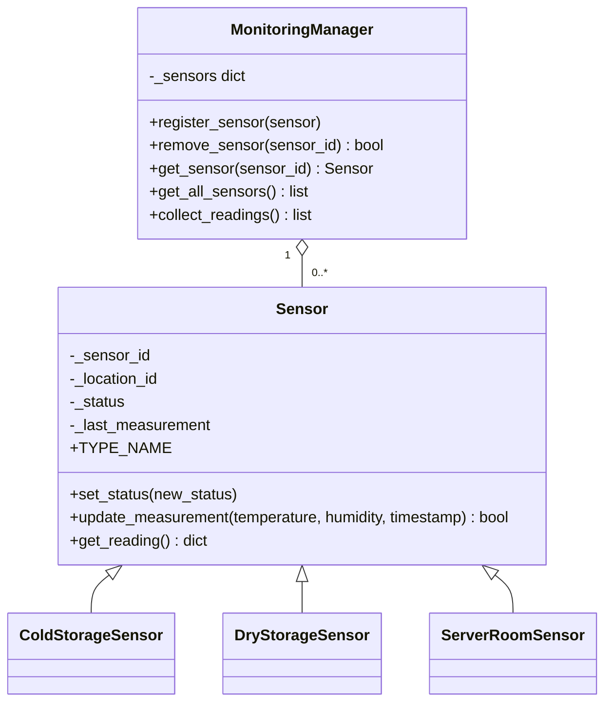
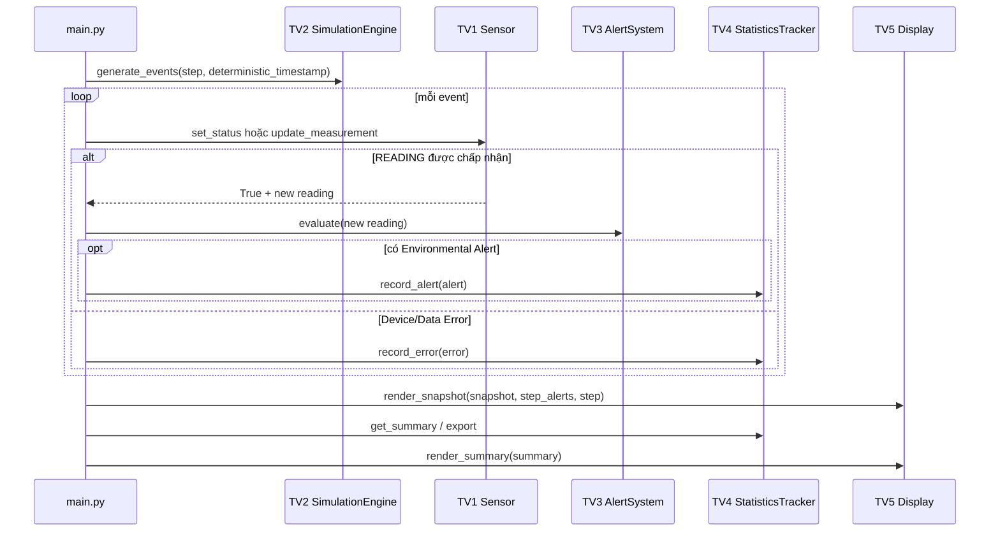

# TV1 — Sensor Architecture and Integration Handoff

## 1. Phạm vi

TV1 sở hữu `sensor.py`, `monitoring_manager.py`, `main.py`, phần cấu hình cảm biến trong `config.py`, test tương ứng và tài liệu này. TV1 không triển khai SimulationEngine, AlertSystem, StatisticsTracker, Display, threshold hoặc Random Walk.

### Quyết định kỹ thuật

- Chỉ dùng Python Standard Library và `unittest`, không thêm dependency ngoài.
- Tách `Sensor`, `MonitoringManager` và orchestrator theo đúng trách nhiệm của từng module.
- `Sensor` kiểm tra toàn bộ dữ liệu trước khi thay measurement để không làm mất giá trị cũ khi validation thất bại.
- `MonitoringManager` dùng dictionary để lookup trung bình O(1) và giữ thứ tự đăng ký khi tạo snapshot.
- `main.py` nhận module TV2–TV5 qua tham số, nhờ đó không triển khai thay hoặc phụ thuộc vào class cụ thể của thành viên khác.

## 2. Class diagram



Ba lớp con chỉ thay `TYPE_NAME`: `COLD_STORAGE`, `DRY_STORAGE`, `SERVER_ROOM`.

## 3. Sensor API

```python
Sensor(sensor_id, location_id, status="ACTIVE")
sensor.set_status(new_status)
accepted = sensor.update_measurement(temperature, humidity, timestamp=None)
reading = sensor.get_reading()
```

- Trạng thái hợp lệ: `ACTIVE`, `INACTIVE`, `ERROR`.
- Chỉ `ACTIVE` nhận measurement. Hai trạng thái còn lại trả `False` và giữ dữ liệu cũ.
- Nhiệt độ/độ ẩm phải là số thực hữu hạn; `bool`, NaN và infinity bị từ chối.
- Timestamp là `None` hoặc chuỗi ISO 8601 hợp lệ; Sensor giữ nguyên chuỗi, không tự tạo thời gian.
- Validation hoàn thành trước khi thay measurement nên lỗi không làm mất dữ liệu cũ.
- `get_reading()` trả dictionary mới, đúng bảy trường:

```python
{
    "sensor_id": "COLD-01",
    "sensor_type": "COLD_STORAGE",
    "location_id": "A",
    "status": "ACTIVE",
    "temperature": 5.0,
    "humidity": 90.0,
    "timestamp": "2026-11-24T08:00:00+07:00",
}
```

Chưa có measurement thì ba trường cuối là `None`.

### Exception

| Điều kiện | Exception |
|---|---|
| Status sai kiểu | `TypeError` |
| Status không thuộc contract | `ValueError` |
| Measurement là bool/không phải số | `TypeError` |
| Measurement NaN/infinity | `ValueError` |
| Timestamp sai kiểu | `TypeError` |
| Timestamp sai ISO 8601 | `ValueError` |

## 4. MonitoringManager API

```python
manager.register_sensor(sensor)
manager.remove_sensor(sensor_id)  # bool
manager.get_sensor(sensor_id)     # Sensor | None
manager.get_all_sensors()         # list[Sensor]
manager.collect_readings()        # list[dict]
```

- Registry là dictionary giữ thứ tự đăng ký.
- Chỉ nhận `Sensor`; ID trùng bị từ chối.
- ID lookup không bị strip/normalize. Sai kiểu gây `TypeError`; rỗng hoặc toàn khoảng trắng gây `ValueError`.
- `get_all_sensors()` trả list mới nhưng các phần tử vẫn là reference Sensor đúng contract.
- Snapshot gồm mọi trạng thái và không nuốt exception từ `get_reading()`.

## 5. Application Orchestrator

`create_default_manager()` tạo ba Sensor từ `config.SENSOR_DEFINITIONS`. `run_simulation(...)` nhận các module TV2–TV5 qua dependency injection để không phụ thuộc implementation cụ thể.



Quan trọng: `AlertSystem.evaluate()` chỉ nhận reading ngay sau khi `update_measurement()` trả `True`. Snapshot chỉ dùng cho hiển thị; không bao giờ được đánh giá lại, nhờ đó không tạo cảnh báo stale hoặc đếm trùng khi refresh.

### Event handling

- `READING`: update Sensor; chỉ reading mới được chấp nhận mới sang TV3.
- `DISCONNECT`: đặt `ERROR`, ghi Device Error, không tạo Environmental Alert.
- `RECOVER`: chỉ chuyển `ERROR` sang `ACTIVE`; không kích hoạt `INACTIVE`.
- `INVALID_DATA`: ghi Data Error, không update hoặc evaluate.
- Sensor ID không tồn tại: ghi `UNKNOWN_SENSOR`, không evaluate.

Timestamp mỗi bước được tạo bằng `start_time + step_index * step_seconds`, độc lập clock của máy.

## 6. Hướng dẫn tích hợp

### TV2 — SimulationEngine

Triển khai `generate_events(step_index, timestamp) -> list[dict]` theo Event Schema. Không gọi Sensor trực tiếp. `main.py` truyền timestamp xác định và tự áp dụng event.

### TV3 — AlertSystem

Triển khai `evaluate(reading) -> dict | None`. Reading luôn là measurement mới đã qua validation và thuộc Sensor ACTIVE. Không cần và không được quét snapshot.

### TV4 — StatisticsTracker

Triển khai `record_alert`, `record_error`, `get_summary`, `export_csv`, `export_json`. Alert được chuyển nguyên vẹn từ TV3. Error Record hiện dùng tạm:

```python
{
    "kind": "DISCONNECT | INVALID_DATA | UNKNOWN_SENSOR",
    "sensor_id": "...",
    "timestamp": "...",
    "message": "...",
}
```

Schema này là integration assumption, chưa phải baseline đã phê duyệt; TV1 và TV4 cần chốt trước real integration.

### TV5 — Display

Cung cấp `render_snapshot(readings, alerts, step_index)` và `render_summary(summary)`. `readings` có cả Sensor ACTIVE, INACTIVE, ERROR; TV5 phải thể hiện rõ giá trị cũ của Sensor lỗi/không hoạt động không phải reading mới.

## 7. Độ phức tạp

| Thao tác | Thời gian trung bình | Bộ nhớ bổ sung |
|---|---:|---:|
| Register/get/remove Sensor | O(1) | O(1) mỗi Sensor |
| get_all_sensors | O(n) | O(n) cho list mới |
| collect_readings | O(n) | O(n) cho snapshot |
| process_event | O(1) ngoài dependency được gọi | O(1) |
| một bước mô phỏng | O(e + n) | O(a + n) |

Trong đó `n` là số Sensor, `e` là số event trong bước, `a` là số alert của bước.

## 8. Kiểm thử và trạng thái tích hợp

Chạy:

```powershell
python -m unittest discover -s tests -v
```

Kết quả kiểm thử hồi quy ngày 25/11/2026: **35 test chạy, 35 PASS, 0 FAIL, 0 SKIP**.

Test bao phủ Sensor, Manager và orchestrator. Orchestrator hiện được kiểm tra bằng test double cho TV2–TV5. Real integration chưa thể xác minh vì repository chưa có implementation của bốn module đó.

## 9. Integration findings

1. `INT-001` — MEDIUM — Error Record Schema chưa được Master Handoff khóa đầy đủ; cần TV1/TV4 thống nhất.
2. `INT-002` — MEDIUM — Summary Schema chưa có cấu trúc cụ thể; `main.py` chỉ chuyển nguyên kết quả `get_summary()` sang TV5.
3. `INT-003` — HIGH (system integration) — TV2–TV5 chưa có trong repository tại thời điểm bàn giao; chưa thể chạy chương trình end-to-end thật.
